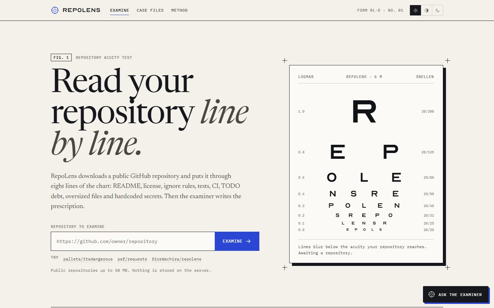
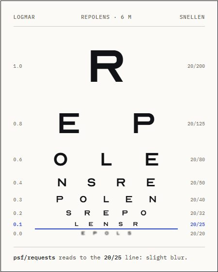
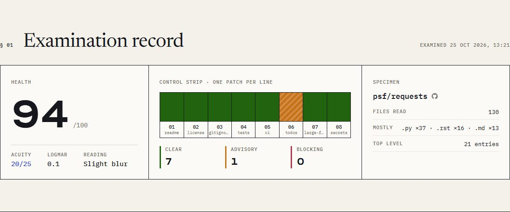
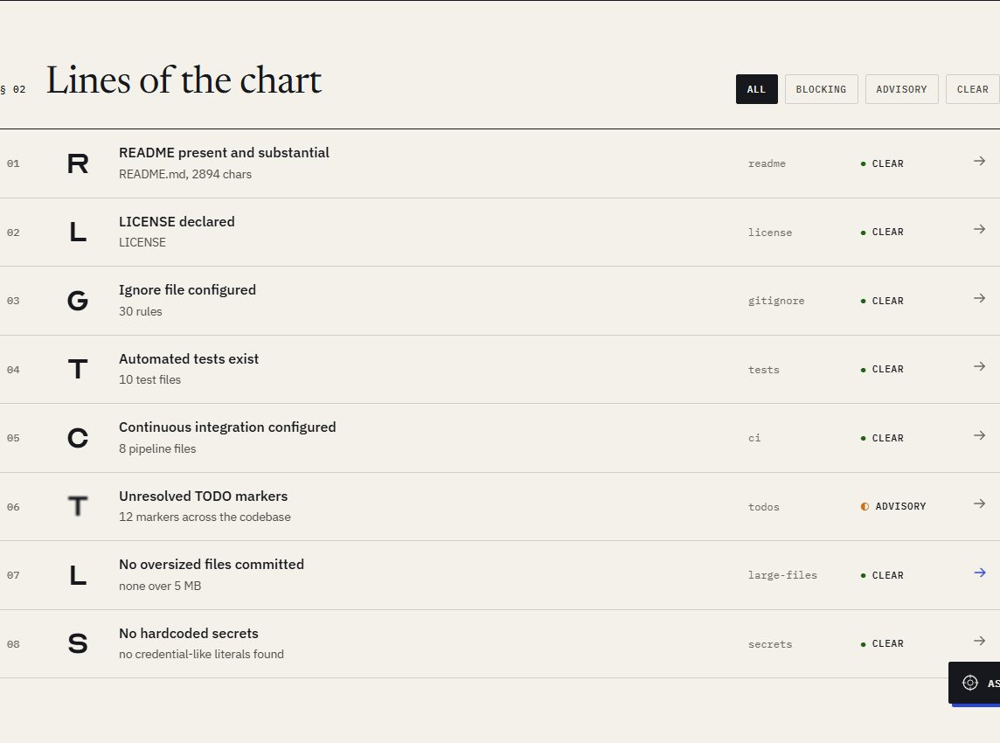
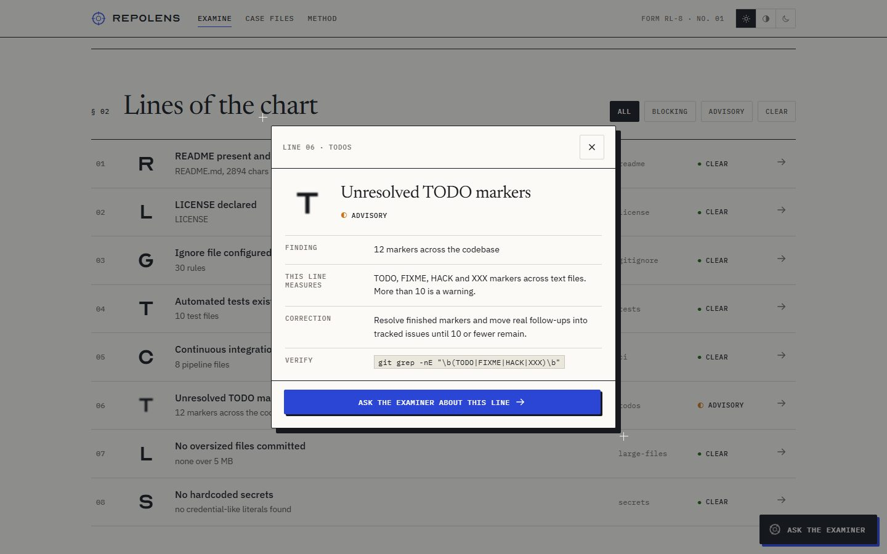
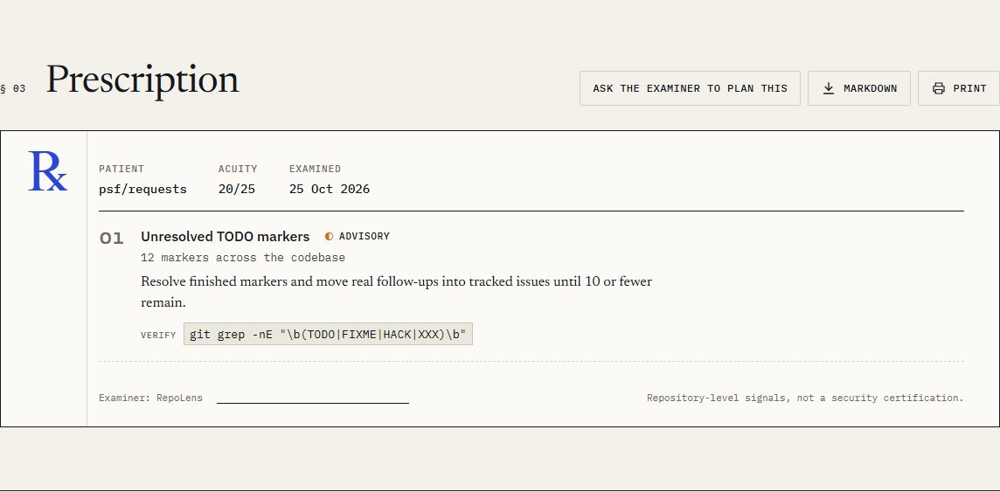
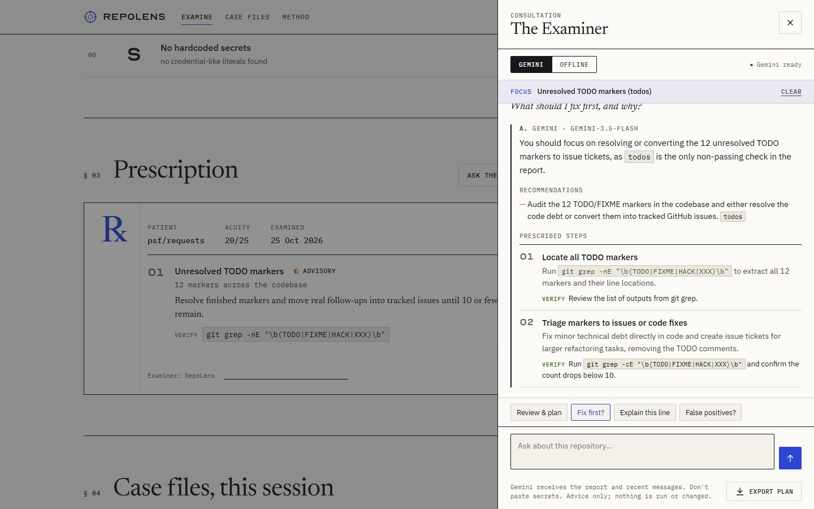
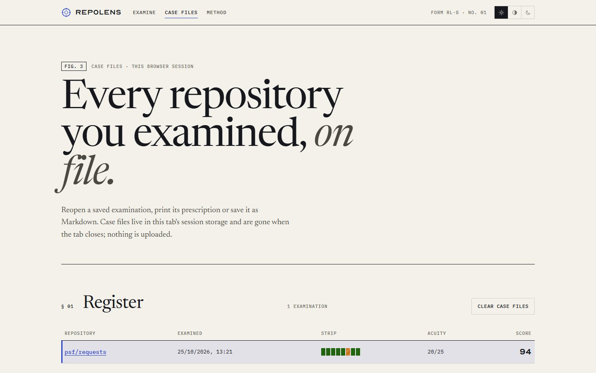
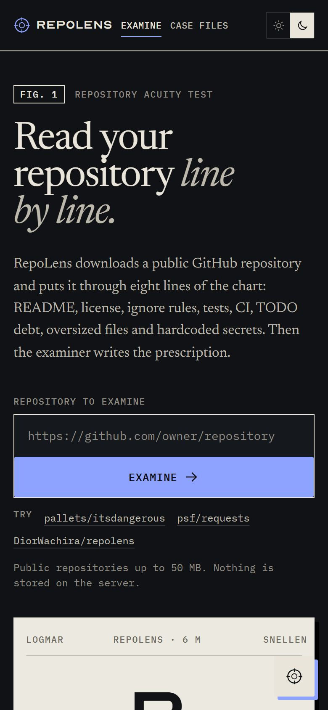

# Using RepoLens

**Live site: <https://repolens-klm1.onrender.com>**

RepoLens examines a public GitHub repository and reads its health the way an optometrist reads an eye chart. You paste a repository link and get back three things. The **examination record** gives a score, an acuity reading and one patch per check. The **lines of the chart** explain each check. The **prescription** lists what to fix and how to prove it is fixed. An optional AI **Examiner** answers questions about the result.

> **First visit after a quiet spell?** The site runs on a free instance that sleeps when idle, so the first page load can take up to a minute. After that it is quick.

## Contents

1. [Examine a repository](#1-examine-a-repository)
2. [Read the examination record](#2-read-the-examination-record)
3. [Lines of the chart and the inspection slip](#3-lines-of-the-chart-and-the-inspection-slip)
4. [The prescription](#4-the-prescription)
5. [Ask the Examiner](#5-ask-the-examiner)
6. [Case files](#6-case-files)
7. [Themes, phones and keyboard use](#7-themes-phones-and-keyboard-use)
8. [Limits and privacy](#8-limits-and-privacy)
9. [Troubleshooting](#9-troubleshooting)

## 1. Examine a repository

1. Open <https://repolens-klm1.onrender.com>.
2. Paste a repository address into **Repository to examine**, for example `https://github.com/psf/requests`. A trailing `.git` is fine; links to issues, branches or files are not, because the address must be the repository itself.
3. Press **Examine**, or try one of the sample repositories under the field.

A progress meter modelled on a lens-resolution test target lights up as RepoLens downloads the archive, extracts it and runs each check. Most repositories finish in a few seconds. Afterwards the page scrolls to the record.

The acuity chart on the right then shows how far down your repository "reads". Lines finer than its acuity blur out, and the line it reached is underlined in blue.

## 2. Read the examination record

| Part | What it tells you |
| --- | --- |
| **Health** | The score out of 100. Each check scores 1 when clear, ½ for an advisory and 0 when blocking; the average becomes the score. |
| **Acuity** / **logMAR** | The same score on an eye-chart scale: 100 reads the 20/20 line and 0 reads 20/200. It is a quick way to say "sharp", "slight blur", "blurred" or "severe blur". |
| **Control strip** | One numbered patch per check, in chart order. Solid patches are clear, diagonal stripes are advisory, and dense cross-hatching is blocking, so the strip reads correctly without colour. |
| **Clear / Advisory / Blocking** | How many checks landed in each state. |
| **Specimen** | The repository, a link to it on GitHub, how many files were read, the most common file types and how many top-level entries it has. |

The score is a navigation aid, not a grade. A single blocking line, especially `secrets`, matters more than the average suggests.

## 3. Lines of the chart and the inspection slip

Each of the eight checks is a "line" with its own letter. The letter is crisp when the check is clear, slightly blurred for an advisory and heavily blurred when blocking. Use **All / Blocking / Advisory / Clear** to filter the list.

| Line | Clear when | Advisory when | Blocking when |
| --- | --- | --- | --- |
| `readme` | A root README has at least 300 characters | It is shorter | There is none |
| `license` | A LICENSE, LICENCE or COPYING file exists | It is missing | — |
| `gitignore` | A root `.gitignore` exists | It is missing | — |
| `tests` | Test files exist (`.py`, `.js`, `.ts`, `.java`, `.go`, `.rs` with "test" in the name) | — | None are found |
| `ci` | GitHub Actions, GitLab CI, Azure Pipelines or a Jenkinsfile exists | None is found | — |
| `todos` | 10 or fewer TODO/FIXME/HACK/XXX markers | More than 10 | — |
| `large-files` | No file is over 5 MB | Any file is | — |
| `secrets` | No credential-like literals | — | AWS keys, private key blocks, or `password`/`token`/`api_key` set to a literal |

Click a line to open its **inspection slip**:

- **Finding:** what RepoLens saw.
- **Evidence:** exact locations, where the check has them (`file:line` for secrets, file and size for large files).
- **This line measures:** what the check looks for and its threshold.
- **Correction:** the standard fix.
- **Verify:** a command you can run in your own clone to confirm the fix.
- **Ask the Examiner about this line:** opens the Examiner with this check as its focus.

Close the slip with the **×** button, by clicking outside it, or with <kbd>Esc</kbd>.

## 4. The prescription

The prescription (℞) lists every line that is not clear, worst first. Exposed credentials always come first, then blocking lines, then advisories. Each entry has the finding, the correction, any evidence and a **Verify** command.

| Button | Does |
| --- | --- |
| **Ask the Examiner to plan this** | Opens the Examiner and asks for a prioritized, step-by-step fix plan. |
| **Markdown** | Downloads the full examination as a `.md` file, with a checklist you can paste into an issue or pull request. |
| **Print** | Opens a print-ready prescription, which you can save as PDF from the print dialog. Allow pop-ups for the site if nothing appears. |

## 5. Ask the Examiner

Open it with **Ask the Examiner** in the bottom-right corner, or from a prescription or inspection slip.

**Modes**

- **Gemini:** answers come from Google's Gemini model, grounded in your examination. The header shows "Gemini ready" when the server has a key, and each answer is labelled with the model that wrote it.
- **Offline:** answers come from the report alone, with no network request. They are good for "what should I fix first?", "build a fix plan" and "explain this line". If Gemini is unavailable, the Examiner switches to Offline automatically.

**Asking good questions**

- Use the quick prompts: **Review & plan**, **Fix first?**, **Explain this line** and **False positives?**
- Or type your own and press <kbd>Enter</kbd> (<kbd>Shift</kbd>+<kbd>Enter</kbd> adds a new line).
- When a check is open, a **Focus** bar shows it, and questions are answered about that check. Press **Clear** to ask about the whole report again.
- Follow-ups build on the conversation. After a plan, "explain step two" or "give me the exact command for step one" refer back to those steps instead of starting over.
- Each answer ends with suggested follow-up questions; click one to ask it.

**What you get back**

- A direct answer to the question first.
- **Recommendations**, tagged with the checks they address, for reviews and "what first" questions.
- **Prescribed steps** with a **Verify** line each, when you ask for a plan.

**Buttons along the bottom**

- **Export plan:** downloads the latest plan as a Markdown checklist.
- **Cancel:** stops waiting for an answer that is taking too long.
- **Retry:** asks the same question again after an error.

The Examiner gives advice only. It cannot see your code beyond the report, and it never runs commands or changes files. Check its suggestions before acting on them.

## 6. Case files

Every examination in the current browser tab is filed under **Case files** (top navigation). The register shows each repository, when it was examined, its control strip, acuity and score. Open one to see its record and prescription again, and download it as Markdown or print it.

Case files live only in this tab's session storage. They disappear when the tab closes, are never uploaded, and **Clear case files** removes them immediately. The dashboard also lists this session's case files near the bottom.

## 7. Themes, phones and keyboard use

- **Theme:** the three buttons at the top right switch between light, system and dark. Your choice is remembered in this browser. In dark mode the chart stays lit, like a chart in a darkened exam room.
- **Phones:** every page works at phone width. The Examiner opens full screen and the chart scales down.
- **Keyboard:** everything is reachable with <kbd>Tab</kbd>. A **Skip to the examination** link appears on the first <kbd>Tab</kbd>, and <kbd>Esc</kbd> closes the inspection slip and the Examiner.

## 8. Limits and privacy

| Limit | Value |
| --- | --- |
| Repositories | Public GitHub repositories only, examined on their default branch |
| Archive size | Up to 50 MB compressed, 300 MB extracted, 20,000 files |
| Examinations | 12 per visitor every 10 minutes |
| Examiner questions | 40 per visitor every 10 minutes |
| Examiner wait | Up to 2 minutes per answer |

**What leaves your browser**

- Examining sends the repository address to the RepoLens server. The server downloads the archive into a temporary folder, runs the checks and deletes it. Nothing is kept.
- With **Gemini** selected, the examination report and your recent questions are sent to Google to produce an answer. Do not paste secrets into the Examiner. **Offline** sends nothing.
- Case files and your theme stay in your browser.

**What RepoLens is not:** a code review, a dependency vulnerability scanner or a security certification. The `secrets` check is a pattern-based heuristic. It can miss real credentials and flag harmless strings, so use a dedicated secret scanner for assurance.

## 9. Troubleshooting

| What you see | What to do |
| --- | --- |
| The page takes a long time to load | The free server was asleep. Wait up to a minute; it stays awake while in use. |
| "URL must look like https://github.com/owner/repository" | Paste the repository address itself, not an issue, branch or file link. |
| "…was not found, is private, or has no commits" | Check the spelling. Private repositories cannot be examined. |
| "repository archive is larger than 50 MB" or "expands to more than 300 MB" | The repository is too big for the hosted site. Run the [command-line tool](../README.md#quick-start) on a local clone instead. |
| "Too many requests from this address" | You hit the rate limit. Wait a few minutes. |
| The Examiner says "No API key on server" | The deployment has no Gemini key. Use **Offline**, or ask the site owner to configure one. |
| "Quota or rate limit reached" from Gemini | The shared Gemini quota is used up for now. Retry later or switch to **Offline**. |
| "The server restarted…" or "job not found" | The server was redeployed or woke up mid-request. Press **Retry**, or examine again. |
| **Print** does nothing | Allow pop-ups for the site, then try again. |

Something else wrong? [Open an issue](https://github.com/DiorWachira/repolens/issues/new) with the repository you examined and what you saw.
